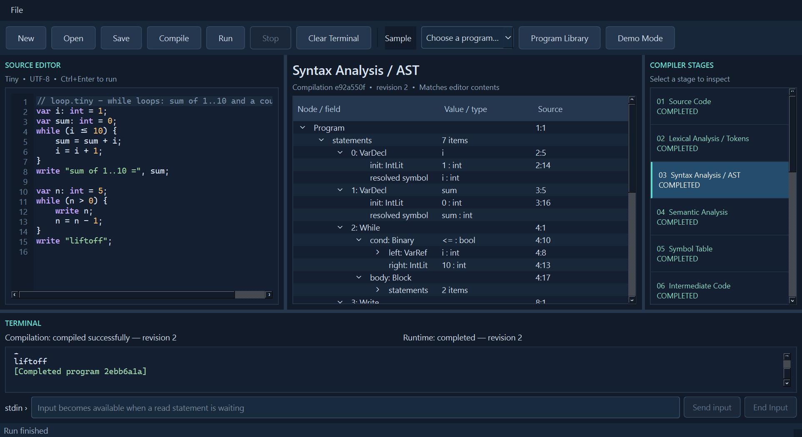

# Tiny Compiler IDE

A desktop IDE for writing Tiny programs and exploring the real compiler pipeline. The PySide6 interface has a highlighted editor with line numbers, individual stage inspectors, eight selectors on the right, and a terminal that remains visible as you explore.

The sidebar also includes a live pipeline diagram, IR control-flow graph, recorded VM trace, searchable Program Library and conservative Complexity Analysis. The original eight compiler stages retain their positions. See the [user guide](docs/USER_GUIDE.md) for the full workflow.



## Install and launch on Windows

Use 64-bit Python 3.10 or newer. In PowerShell, from the extracted project folder:

```powershell
python -m venv .venv
.\.venv\Scripts\python.exe -m pip install -r requirements.txt
.\.venv\Scripts\python.exe gui.py
```

No environment activation or execution-policy change is needed. Launch with an existing file:

```powershell
.\.venv\Scripts\python.exe -m tiny_compiler.ide examples\gcd.tiny
```

PySide6 is the GUI's only direct dependency. The compiler and CLI still use only the standard library. Report generation optionally needs `requirements-dev.txt`.

## Workflow

1. Edit the initial sample, choose **Sample**, or use **Open**. Samples open as editable unsaved copies.
2. After a **350 ms typing pause**, the real compiler refreshes tokens, AST, semantics, symbols, IR, VM code, CFG and complexity. Compilation never runs the program automatically. **Compile** also builds immediately.
3. Select any stage on the right, including while a worker runs or waits for input. Navigation does not execute code or clear the terminal.
4. Click **Run** to execute the successful compilation of the exact current source. It reuses current bytecode when available and compiles first when necessary. Invalid current source cannot execute older code. For each `read`, type in the bottom terminal field and press Enter or **Send input**. Values may share a line: enter `84 36` for `gcd.tiny`. Booleans are `true` or `false`. No external terminal or command-line input argument is needed.
5. **Stop** cancels execution or an input wait. Compiler cancellation is checked between stages. The VM also has a 5,000,000-instruction limit.
6. **End Input** sends EOF to a waiting read and produces the VM's normal input-exhausted diagnostic. Editing marks retained stages stale until the automatic compilation catches up. While an older VM runs, its input/output remains attached to that execution; compilation inspectors follow the edited source. Runtime and compilation revision labels show the distinction.

The terminal streams actual output, prompts, echoed input, errors and running/waiting/completion records in distinct colors until **Clear Terminal** is clicked. Compilation and runtime status labels remain visible above it. Tokens, ASTs, IR and VM listings appear only in their inspectors. Automatic checks keep diagnostics in the editor and inspectors without filling the terminal. Clearing preserves results and any pending input request. Runtime results and trace remain available when a newer source is compiled, with their earlier source version clearly labelled.

| Control | Shortcut | Behavior |
|---|---|---|
| New / Open / Save | Ctrl+N / Ctrl+O / Ctrl+S | UTF-8 files and unsaved-change protection |
| Save As | Ctrl+Shift+S | Available in File menu |
| Compile | F5 | Build reachable stages |
| Run | Ctrl+Enter | Reuse current compilation or compile first; execute in worker |
| Stop | Shift+F5 | Cancel execution or pending input |
| Clear Terminal | Ctrl+L | Clear terminal display |

Resize panels with the splitters. Double-click token, symbol or AST rows to navigate to source when results are current. Expand AST nodes to inspect their structure and actual semantic type/symbol annotations.

## Smart editor

Type a keyword prefix or press **Ctrl+Space** for supported Tiny keywords, operators, statements, templates and analyzer-resolved variables in lexical scope. Use Up/Down to choose, Enter/Tab to accept, or Esc to dismiss. Suggestions replace only the typed prefix and never execute code. No functions, arrays, `for`, `print`, or other unsupported syntax is suggested. Tiny has `read`/`write` statements, not callable built-in functions.

The editor pairs parentheses, braces and double quotes; indents blocks; highlights matching brackets; and offers hover descriptions. Debounced background compilation updates all stage snapshots and underlines real diagnostics. Revision guards reject late results from older edits. Ctrl+Z/Ctrl+Y and standard cut/copy/paste/select-all shortcuts remain available. Square brackets are not paired because Tiny does not support arrays.

## Program Library and Demo Mode

**Program Library** on the toolbar or sidebar opens 27 categorized programs: 23 valid examples and four explicitly labelled intentional error demonstrations. Each has a description, concepts, source preview, sample input, expected output and expected diagnostic where applicable. Load creates an unsaved editable copy; Run Example uses documented sample input; Inspect Compilation builds without running. Original library files are not changed by loading or editing.

Enable **Demo Mode** to open the live pipeline when compiling/running. Navigate freely among all results. The trace's **Replay Step**, **Replay Continue**, **Pause Replay** and **Reset Replay** navigate captured instructions and highlight source lines; they do not re-execute the VM or act as debugger breakpoints.

## Graphs and complexity

The pipeline uses real stage statuses and links to the corresponding inspector. The CFG partitions actual IR into basic blocks with labelled true/false, jump and next edges, including loop back edges and short-circuit logic. Select blocks for full instructions, pan, zoom with Ctrl+wheel, or use Fit. Symbol search filters actual table rows.

VM history records instruction pointer, next pointer, instruction, source line, post-instruction variables/temporaries, stack and output delta, including failed instructions. Capture is limited to the first 2,000 instructions, 256 variable values and 256 stack values per row, and 4,096 output characters per instruction. Truncation is labelled; program execution and terminal output continue normally.

Complexity Analysis estimates **asymptotic upper bounds**, separately from actual VM instruction counts. It supports monotone linear counters, multiplication/division by a constant factor, invariant bounds, and independent nested loops with reset counters. It reports **Unable to determine** for unsupported or ambiguous patterns such as GCD's recurrence, compound loop conditions, conditional updates or dependent bounds. Literal-bound loops are O(1) with respect to runtime input. Space is O(1) **scalar slots** for this fixed scalar language; Python integer bit sizes and IDE/input/output buffers are explicitly excluded. It does not claim exact time or bytes. See [analysis scope](docs/COMPLEXITY.md).

## Inspectable stages

| Stage | Data from the actual run |
|---|---|
| Source Code | Captured source snapshot |
| Lexical Analysis | Token kind, raw lexeme, decoded value, line and column, including EOF |
| Syntax Analysis | Expandable AST; recovered partial tree on syntax errors |
| Semantic Analysis | Analyzer diagnostics, check summary and annotated AST |
| Symbol Table | Name, type, scope depth, unique storage, declaration location and usage |
| Intermediate Code | Three-address instructions generated from the annotated AST |
| Target / VM Code | Indexed stack-machine instructions generated from the IR |
| Execution / Diagnostics | Program output, diagnostics, instruction count and final VM memory |

Statuses distinguish pending, active, completed, waiting, partial, error, blocked, cancelled and not run. Errors preserve earlier results and block later stages. Semantic errors retain partial declarations. Fast stages may complete too quickly for their active state to be visible.

## Tiny example

```text
var a: int;
var b: int;
read a;
read b;
while (b != 0) {
    var t: int = b;
    b = a % b;
    a = t;
}
write "GCD =", a;
```

The existing typed Tiny dialect supports `int`, `bool`, block scope, shadowing, assignment, `if`/`else`, `while`, `read`, `write`, arithmetic, comparisons and short-circuit logic. Strings are permitted in `write`, not as variable types. Comments use `//` or `/* ... */`. See [language specification](docs/LANGUAGE_SPEC.md) and [grammar](docs/GRAMMAR.md).

## Test and verify

```powershell
$env:QT_QPA_PLATFORM = "offscreen"
.\.venv\Scripts\python.exe -m unittest discover -s tests -t . -v
# Save fresh test evidence:
.\.venv\Scripts\python.exe tools\verify_project.py
# Launch a native window and capture real screenshots:
Remove-Item Env:QT_QPA_PLATFORM -ErrorAction SilentlyContinue
.\.venv\Scripts\python.exe tools\verify_gui.py
```

On Windows, **272 tests passed with zero skips**, including all 198 original compiler/CLI tests and 15 real-time/terminal acceptance tests. The suite verifies every valid library example against independent expected fixtures through VM, TAC and GUI execution, and checks each intended error. Native Qt platform `windows` also launched and exercised all sidebar views, automatic stage compilation, cached Run, sequential input typed in the terminal, errors, Demo Mode, CFG/trace, completion and complexity. Evidence is in [testing documentation](docs/TESTING.md), `docs/test-results.json`, `tests/latest-results.txt` and `screenshots/verification.json`. Without PySide6, GUI tests are skipped; that does not verify desktop functionality.

## Command line compatibility

```powershell
python main.py examples\hello.tiny
python -m tiny_compiler examples\loop.tiny --all
python main.py examples\gcd.tiny --input "84 36"
python main.py examples\arithmetic.tiny --tokens --ast --symbols --ir --code --check
python main.py examples\loop.tiny --backend ir
```

CLI options, VM/TAC execution, exit codes and expected outputs are preserved. `main.py` remains the CLI; `gui.py` is the desktop launcher.

## Files

```text
Tiny-compiler/
  gui.py, main.py                 desktop and CLI launchers
  requirements.txt               PySide6
  requirements-dev.txt           optional report libraries
  tiny_compiler/
    lexer.py, parser.py, ast_nodes.py
    semantic.py, symbol_table.py, diagnostics.py
    pipeline.py, ir.py, codegen.py, runtime.py, vm.py, cli.py
    completion.py, control_flow.py, execution_trace.py
    program_library.py, complexity.py
    ide/
      __main__.py                desktop entry point
      window.py                  layout, actions, navigation and terminal
      editor.py                  line numbers and syntax highlighting
      views.py                   artifact inspectors
      worker.py                  compiler and VM QThread
      session.py                 run state and queued input/output
      terminal.py                formatted persistent terminal transcript
      visuals.py, library.py     graphs, trace replay and program library
      editor_analysis.py         debounced revision-guarded stage compilation
  examples/                      13 original programs plus 27 library programs
    library.json, library/       metadata and source fixtures
  tests/                         original tests, test_ide.py, latest-results.txt
  docs/                          architecture, language, grammar, test evidence
  screenshots/                   native window/popup captures and verification JSON
  report/Tiny_Programming_Language_Compiler_Report.docx
  tools/                         report, verification and packaging utilities
  dist/Tiny-Compiler-IDE.zip      source distribution
```

See [architecture](docs/ARCHITECTURE.md) for the implementation. The editable Word report maps the GUI to the Review 2 requirements.

## Report and package

```powershell
.\.venv\Scripts\python.exe -m pip install -r requirements-dev.txt
.\.venv\Scripts\python.exe tools\build_report.py
.\.venv\Scripts\python.exe tools\package_project.py
```

The report builder reads recorded evidence; refresh it with the verification commands after changing code. It does not silently invent or rerun test results.

## Limitations

- Target code runs on the included VM; it does not produce a native executable.
- Compiler cancellation occurs between passes. Large sources can take time to parse, copy and display; the IDE is intended for teaching-sized programs.
- The newest compilation and most recent execution are retained separately. Terminal and run state live in memory until the window closes.
- No functions, arrays, floats, optimizer, breakpoints or VM instruction stepping.
- Trace controls replay a bounded recorded history. Completion and static analysis are conservative, and complexity is a unit-cost scalar model rather than a Python bit-complexity analysis.
- Windows was exercised; Linux and macOS were not tested. Smaller windows can require scrolling or resizing panels.
- The ZIP contains sources, not Python, an offline installer or a standalone `.exe`.
